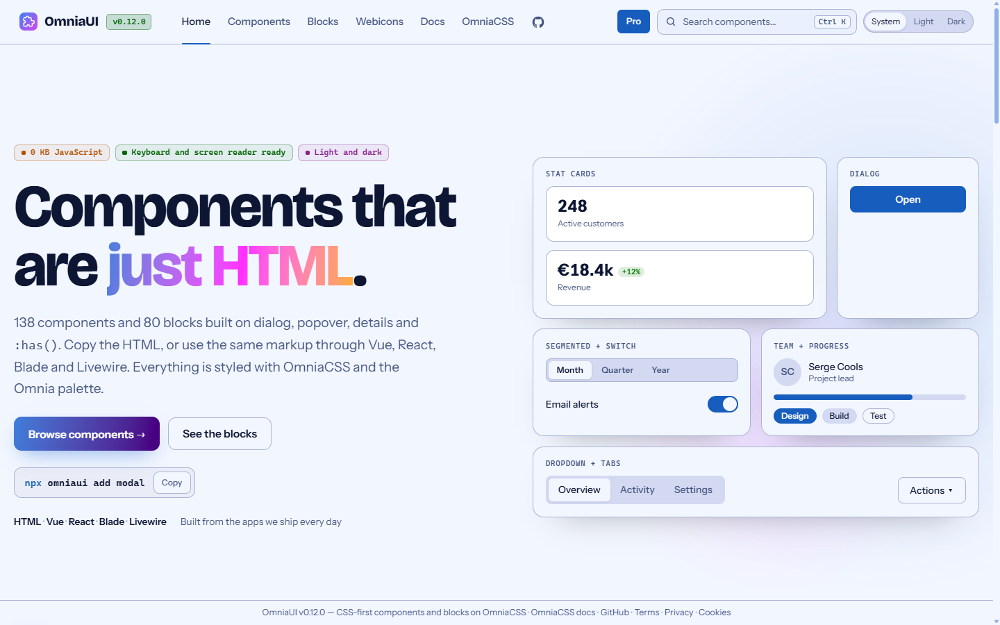
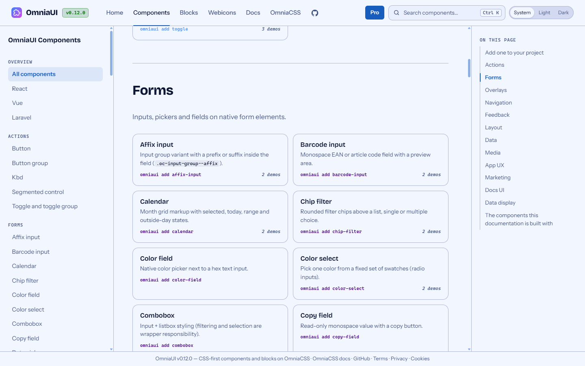
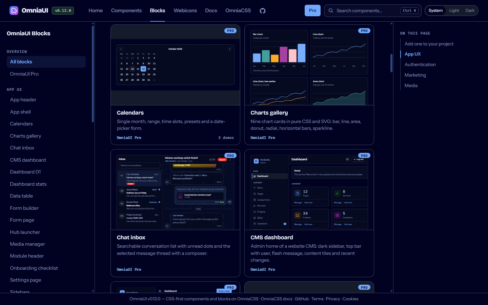
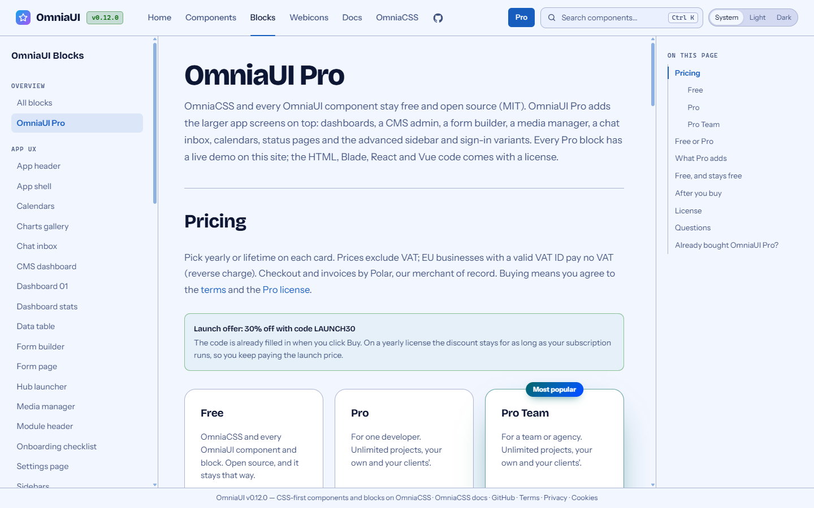

<!-- File: README.md | Map: intro -> badges -> version -> showcase -> packages -> install -> Pro -> dev workflow -> vendored OmniaCSS -> PHP -> recent changes -->
# OmniaUI

CSS-first components and blocks, built on the utilities of [OmniaCSS](https://omniacss.eu).
As little JavaScript as possible: popover, dialog, details, `:has()` and anchor positioning do the work.
Wrappers for React, Vue and Laravel (Blade + Livewire) use exactly the same markup and `oc-` classes.

[](LICENSE)
[](https://www.npmjs.com/package/@birdycom/omniaui)
[](https://github.com/Birdycom/OmniaUI/actions/workflows/ci.yml)
[](https://github.com/Birdycom/OmniaUI/actions/workflows/release.yml)
[](https://github.com/Birdycom/OmniaUI/actions/workflows/split-php.yml)
[](CONTRIBUTING.md)

**Version:** `0.12.0` — the same value in `package.json`, every `@birdycom/omniaui*` package and OmniaCSS (`MAJOR.MINOR.PATCH`).

**Site:** https://omniaui.eu · **CSS docs:** https://omniacss.eu/docs/index.html · **CSS framework:** [OmniaCSS](https://github.com/Birdycom/OmniaCSS)

## Showcase

A short tour: the homepage, the components gallery, a component page (tooltip placement with anchor positioning),
the data table, the blocks gallery in dark mode, a Pro block (CMS dashboard) and OmniaUI Pro.


| | |
|---|---|
|  |  |
| Homepage | Components gallery: every component with its `npx omniaui add` command |
|  |  |
| Blocks gallery in dark mode, Pro blocks marked | OmniaUI Pro: app blocks with a commercial license |

## Packages

| Package | Folder | Contents |
|---|---|---|
| `@birdycom/omniaui` | `packages/ui` | Component CSS (`dist/components.css`), HTML snippets, `manifest.json`, CLI `omniaui` (add/list) |
| `@birdycom/omniaui-blocks` | `packages/blocks` | Block CSS (`dist/blocks.css`) and block snippets (app shell, hero, auth, …) |
| `@birdycom/omniaui-react` | `packages/react` | React components (`<Button>`, `<BlockHero>`) |
| `@birdycom/omniaui-vue` | `packages/vue` | Vue 3 components (`<OcButton>`, `<OcBlockHero>`) |
| `@birdycom/omniaui-site` (private) | `apps/site` | Astro site with the components, blocks and webicons pages |
| `birdycom/omniaui-laravel` (Composer) | `php-packages/omniaui-laravel` | Anonymous Blade components `<x-oc::button>`, `<x-oc::block.hero>`, `@omniacss` directive |
| `birdycom/omniaui-livewire` (Composer) | `php-packages/omniaui-livewire` | Livewire 3 components with `wire:model`, modals, toasts, DataTable |

`@birdycom/omniaui` depends on `@birdycom/omniacss` (the utilities and tokens).

## Install

```bash
npm i @birdycom/omniacss @birdycom/omniaui
# optional
npm i @birdycom/omniaui-blocks @birdycom/omniaui-react   # or @birdycom/omniaui-vue
```

Copy a component into your project (HTML, React or Vue, depending on your framework):

```bash
npx omniaui list
npx omniaui add button card
```

The OmniaCSS CLI (`npx omniacss build`) includes the OmniaUI CSS automatically when the package is installed.

**In your editor:** [OmniaCSS IntelliSense](https://omniacss.eu/docs/editor) for VS Code and Cursor completes every `oc-*` class
and shows its CSS on hover, from the OmniaUI version your project has installed (Pro classes included when Pro is installed).

## OmniaUI Pro

OmniaUI and every component stay free and open source (MIT). [OmniaUI Pro](https://omniaui.eu/ui/pro.html) adds
34 larger app blocks — CMS dashboard, form builder, media manager, chat inbox, dashboards, calendars, sidebars 06–16
and more — under a commercial license, from a separate private repository.

This repository only holds what the site needs to show them: `vendor/omniaui-pro/pro.css` with the list of names,
and the demo markup on the docs pages (`<oc-demo pro>`: a live preview without code). `packages/blocks/pro.json`
(names only) lets the CLI tell you that a block is part of Pro.

## Dev workflow

Node 22+, Windows/Git Bash or macOS/Linux.

| What | Command |
|---|---|
| Install | `npm install` |
| Build everything (packages, wrappers, site) | `npm run build` |
| Only CSS + manifests | `npm run build:packages` |
| Build React/Vue (also generates `index.ts`) | `npm run build:wrappers` |
| Site locally (Astro dev) | `npm run site:dev` |
| Build the site into `public/` | `npm run site:build` |
| Tests (build + CLI + React + Vue) | `npm test` |
| Regenerate the Blade blocks | `npm run blade:blocks` |
| Update the code syntax theme | `npm run code-syntax-theme` |
| Bump the version | `npm run release -- minor "Description"` |

Adding components or blocks: see [CONTRIBUTING.md](CONTRIBUTING.md). You only create new files;
navigation, routes, manifests, CSS bundles and wrapper indexes are generated.

Locally, Laravel Herd serves `public/` (https://omniaui.test). `public/index.php` serves the home page and redirects
`/docs/` and `/pages/` to OmniaCSS. The URL of the other site lives in one place: `OMNIACSS_URL` in `apps/site/src/lib/site.mjs`.

Publishing: push a tag (`git tag v0.11.1 && git push origin v0.11.1`). The release workflow builds, tests and
publishes to npm with Trusted Publishing. Publish OmniaCSS with the same version first.

## Vendored OmniaCSS

The site build uses a copy of the OmniaCSS build in `vendor/omniacss` (committed): `dist/omnia.css`,
`dist/oc-colors.css`, `src/engine.mjs`, `src/variants.mjs`. With it, the site builds `public/css/omnia-site.css`
(only the utilities it uses), without needing the OmniaCSS repository next to this one.

```bash
npm run sync:omniacss   # reads ../omniacss/packages/core (build there first: npm run build:packages)
```

The other way round, OmniaCSS vendors our `oc-components.css`, `oc-blocks.css` and `oc-code-syntax.css` (`npm run sync:omniaui` in that repository).

## PHP

```bash
cd php-packages/omniaui-laravel && composer install && vendor/bin/phpunit
cd php-packages/omniaui-livewire && composer install && vendor/bin/phpunit
```

See [php-packages/README.md](php-packages/README.md).

## Recent changes

| Version | Date | Changes |
|--------|-------|-----|
| `0.12.0` | 2026-10-28 | Tooltip met anchor positioning, titel en plaatsing; Pro-blocks infinite carousel en pricing plans; carousel-lus; schone URL's; favicons en SEO; lightbox- en kleurfixes |
| `0.11.2` | 2026-10-28 | mobiel site-header-menu, leesbare accenttekst in dark mode, minify behoudt scroll-animaties |
| `0.11.1` | 2026-10-28 | docs layout, browser support and demo fixes |
| `0.11.0` | 2026-10-24 | Chat, CMS dashboard and search in the docs |
| `0.10.0` | 2026-10-23 | Form builder, media manager and cookie consent |
| `0.9.0` | 2026-10-23 | Same version as OmniaCSS: CSS functions and docs |
| `0.8.4` | 2026-10-23 | Same version as OmniaCSS: color docs |
| `0.8.3` | 2026-10-23 | Same version as OmniaCSS: IntelliSense images |
| `0.8.2` | 2026-10-23 | Same version as OmniaCSS: color CSS in IntelliSense |
| `0.8.1` | 2026-10-23 | Linux binaries of Rollup and esbuild stay in the lockfile |
| `0.8.0` | 2026-10-18 | Same version as OmniaCSS: IntelliSense |
| `0.7.0` | 2026-10-16 | List table from Korrekt and OmniaDesk, price and barcode fields on the left |
| `0.6.0` | 2026-10-15 | OmniaUI split off from OmniaCSS: components, blocks, React/Vue, Laravel/Livewire and webicons; npm scope @birdycom. New components for forms, data/app UX, media and marketing, plus the blocks status-page, faq, about-timeline, contact-grid, hero-orbit, profile-header, watch-layout and portfolio-grid. |

## License

MIT — Serge Cools (Birdycom). OmniaUI Pro has its own commercial license.
